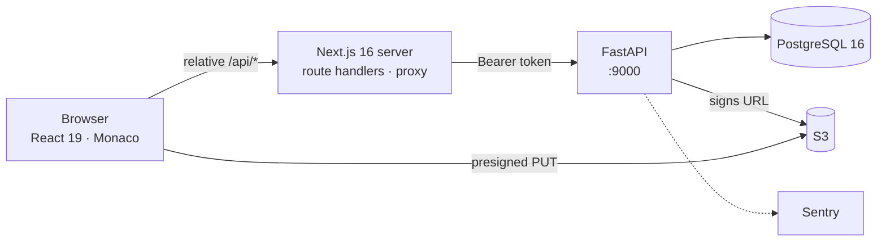
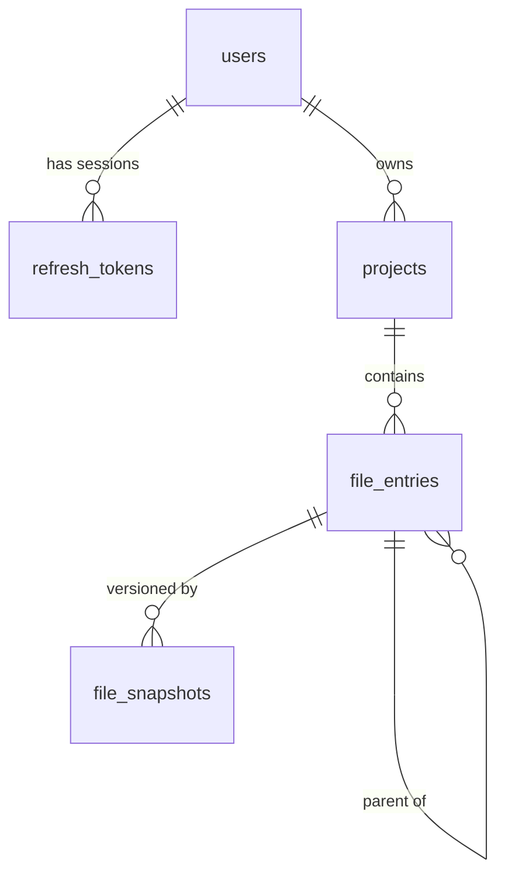
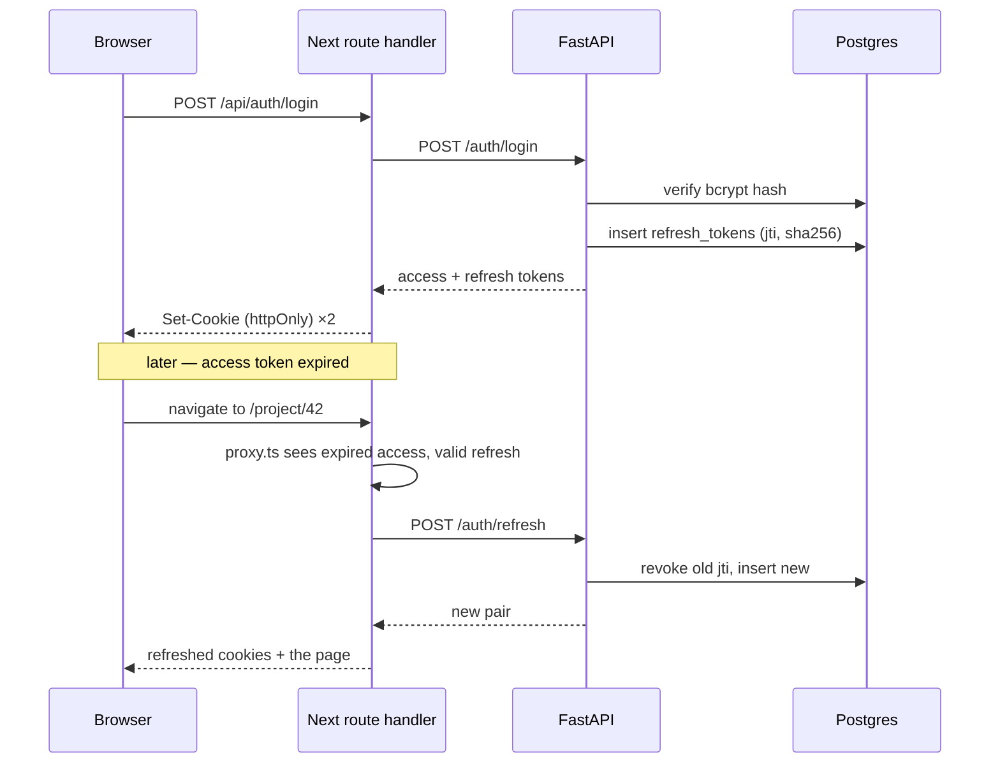
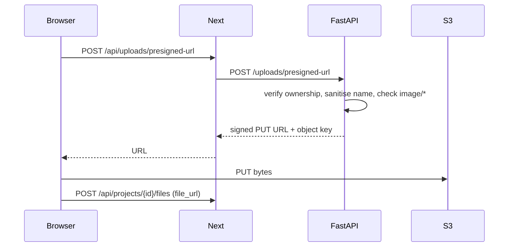

# Software Design Document — Lumen

**Version:** 1.0 · **Status:** Describes the implementation as of this commit

Describes *how* Lumen meets the [SRS](srs.md). Requirement IDs (FR-x, NFR-x) refer to that
document. Decisions with lasting consequences are recorded as [ADRs](decisions/) and cited
inline rather than re-argued here.

---

## 1. System context



### 1.1 Design boundaries

Four boundaries generate most of the design. Each is deliberate.

**B1 — The browser never calls FastAPI.** All client traffic goes to Next route handlers
under `app/api/` by relative path. In production the backend publishes no port
(`docker-compose.prod.yml`), so it is reachable only over the compose network (NFR-S7).

**B2 — The Next server owns the session.** Tokens live in httpOnly cookies set by
`lib/auth/cookies.ts`; client JavaScript cannot read them (NFR-S3). Route handlers read the
cookie and attach a Bearer header when calling FastAPI.

**B3 — File bytes bypass the API.** The backend only *signs* upload URLs; the browser PUTs
directly to S3, so a large upload never occupies an API worker (FR-5.4, NFR-P3).

**B4 — One response shape.** `ApiResponseBuilder` wraps every response, and the exception
handlers in `src/main.py` force errors into the same envelope, so clients branch on one
shape rather than distinguishing JSON errors from HTML error pages.

---

## 2. Architectural design

### 2.1 Backend: domain packages

One package per domain under `src/`, each with four files and one responsibility each:

| File | Holds |
|---|---|
| `models.py` | SQLModel tables |
| `schemas.py` | Pydantic request/response models |
| `router.py` | Endpoints — thin; no business logic |
| `service.py` | Validation, authorisation, database work |

Routers stay thin so behaviour is testable without HTTP (NFR-M1): `tests/unit/` calls
services directly, `tests/api/` covers only the wiring.

Domains: `auth`, `projects`, `file_entries`, `file_snapshots`, `uploads`. Cross-cutting
code sits outside them — `shared/project_access.py` (ownership), `core/` (settings,
envelope, security, observability), `db/` (engine, session, migrations).

> `src/auth/scheema.py` is a legacy misspelling retained to avoid churn; new modules use
> `schemas.py`.

### 2.2 Frontend: route groups

Route groups separate the three areas of the app: `(marketing)` public, `(dashboard)`
authenticated chrome, `project/[id]` the editor. Each route owns its components
(`app/<route>/components/`) and its state (`app/<route>/use-<route>-hook.ts`); only
genuinely shared UI reaches `components/`.

Oversized components become folders split by responsibility, keeping the main export named
after the folder plus an `index.ts`, so import paths never change when a file is split.
`components/editor-sidebar/` and `app/project/[id]/components/editor-workspace/` are the
worked examples.

### 2.3 Why one authorisation function

`get_project_for_user` is the single place a project is resolved for a caller. Every
project, file and upload route goes through it (NFR-M3). The consequence is that adding
collaborators later means changing one function and adding a join table — not auditing
every router. It also centralises the 404-not-403 choice
([ADR 0003](decisions/0003-return-404-for-another-users-resource.md)).

---

## 3. Data design

Five tables. Every foreign key is `ON DELETE CASCADE`, so deleting a user removes their
sessions, projects, files and history in one step (NFR-R3).



### 3.1 users

`id`, `email` (unique, varchar 320), `password_hash` (bcrypt), `name`, `is_active`,
timestamps.

`is_active` is a soft disable: the row survives so projects are not cascaded away, while
login and refresh return 403 (FR-1.12).

### 3.2 refresh_tokens — the session ledger

`id`, `user_id` (FK, indexed), `jti` (unique, indexed), `token_hash` (unique),
`expires_at`, `revoked_at` (nullable), `created_at`.

Only the SHA-256 hash is stored, so a database leak yields no usable session (NFR-S2). The
`jti` identifies one session, making a single device revocable without disturbing the
others (NFR-S8).

### 3.3 projects

`id`, `name`, `user_id` (FK — **the only authorisation boundary**), timestamps.

No membership table: one project, one owner (C-1). `updated_at` carries `onupdate`, and
`touch_project` also bumps it whenever a file inside changes, so "recently edited" ordering
reflects real work rather than renames (FR-2.8).

### 3.4 file_entries — the tree

`id`, `project_id` (FK), `parent_id` (self-FK, nullable — NULL means root), `name`,
`type` (`CHECK IN ('file','folder')`), `mime_type`, `file_url`, timestamps. Indexed on
`project_id`, `parent_id`, and the pair.

**Design choice: adjacency list.** `parent_id` keeps a move or rename to a single row
update, which is what the editor does constantly. The cost is that subtree work recurses in
Python — `_delete_file_entry_tree` and `_is_descendant_entry` issue one query per level.

That recursion is exactly why two guards exist in `update_file_entry` (FR-3.7, FR-3.8): a
folder may not move into itself, nor into any descendant. Either would detach the branch
from the root, leaving rows that are unreachable but undeleted. The guards are enforced
server-side and mirrored in the frontend's `moveNode`, so an invalid drag is rejected
before a request is made.

If trees ever reach thousands of entries, replacing the per-level queries with a recursive
CTE is the first optimisation — nothing else depends on the current shape.

### 3.5 file_snapshots — append-only history

`id`, `file_id` (FK, indexed), `content` (text), `version` (int), timestamps.

A save writes a **new** row at `version = latest + 1`; nothing is updated in place
(FR-4.6, NFR-R1). "Current content" is the highest version, resolved by
`get_latest_file_snapshot` ordering on `version DESC, id DESC`. A future "restore this
version" needs no schema change.

Content is stored whole rather than as diffs: simple and correct, at the cost of storage
proportional to saves × file size. Nothing prunes snapshots today — worth watching before
it matters.

---

## 4. Detailed design

### 4.1 Session lifecycle



**Rotation.** `refresh_user_tokens` sets `revoked_at` on the presented token *before*
issuing a replacement (FR-1.8). A refresh token is therefore single-use: replaying a stolen
one fails, because the row is already revoked.

**Silent refresh.** `proxy.ts` checks `isJwtExpired` with a 30-second buffer, so a token
cannot expire in flight between the check and the API call. The refresh happens before the
page renders, so expiry never surfaces as an unexpected logout (FR-1.7, NFR-U1).

**Validation order on refresh:** token decodes → type is `refresh` → row exists → not
revoked → not expired → user exists → user active. Each failure is distinct, so the client
can tell "log in again" from "your account is disabled" (FR-1.9, FR-1.12).

### 4.2 Loading a project

1. `proxy.ts` guards `/project/*` and refreshes if needed (FR-1.13).
2. `loadProject` calls `GET /api/projects/42`; the handler forwards with a Bearer token.
3. `get_project_for_user` filters by owner — another user's project is a 404 (FR-2.7).
4. `lib/projects.ts#buildFileTree` converts the flat list into a tree, grouping by
   `parent_id`, sorting folders first then alphabetically (FR-3.10), opening root folders
   and leaving nested ones closed (FR-3.11).
5. `createFileContents` and `createSnapshotVersions` seed per-file buffers from the newest
   snapshot; `findInitialOpenFile` prefers `main.tex`, else the first file (FR-4.2).

`preserveOpenState` re-applies the user's expand/collapse state after any server refresh,
because the server has no concept of a folder being open (FR-3.12).

### 4.3 Saving: change coalescing

Monaco emits one change event per keystroke. Sending each would be a request per character,
so the client coalesces before transmitting (FR-4.7, NFR-P1).

`mergePendingSnapshotChange` merges a pair when they are adjacent and the same kind:

| Kind | Merges when | Result |
|---|---|---|
| insert + insert | the second starts where the first ended | one insert, texts concatenated |
| delete + delete | same offset (forward delete) | one delete, lengths summed |
| delete + delete | the second ends where the first began (backspace) | one delete starting earlier |
| replace + replace | adjacent | one replace, lengths and texts combined |

Anything else stays separate. `compactPendingSnapshotChanges` folds a list left-to-right
through that rule, so typing a word produces one change rather than five.

Server-side, `apply_monaco_changes` replays the list against the stored content and
validates each range; an offset past the end is a 400 rather than a corrupted file
(FR-4.8).

### 4.4 Upload flow



Three validations, in order: ownership (FR-5.5), filename, then content type.
`_safe_file_name` takes `PurePath(name).name`, discarding any directory component, and
rejects the results `.` and `..`. The object key is therefore always
`uploads/{project_id}/{basename}` — a traversal attempt cannot escape the project's prefix
(FR-5.3). `_clean_image_content_type` lowercases and trims before requiring the `image/`
prefix (FR-5.2).

### 4.5 Editor state

One Zustand store, `use-project-editor-hook.ts`, holds the tree, open tabs, per-file
buffers, panel visibility and chat state. Actions are callable outside React via
`getState()`, which is how they are tested without a DOM.

Behaviours worth noting:

- **Tabs** — `withOpenFile` updates an existing tab's metadata rather than appending a
  duplicate, and preserves any buffer already present so unsaved work is never discarded
  (FR-4.3, FR-4.4).
- **Closing** — the tab to the left becomes active; closing the last clears the selection
  (FR-4.5).
- **Panels** — `setEditorOpen`/`setPreviewOpen` refuse the toggle that would hide the last
  visible panel, so the workspace cannot be emptied (FR-4.11).
- **Viewport** — `initializeForViewport` collapses the sidebar and preview on mobile
  (FR-4.12).

The workspace component composes this from four parts: `use-panel-sizing` (viewport and
container-width bounds), `use-editor-mount` (Monaco listeners), `use-editor-selection`
(the selection popup) and `editor-panel` (the pane itself).

---

## 5. Interface design

### 5.1 Response envelope

```json
{ "success": true, "message": "Project created successfully.", "data": { } }
```

`message` is **`null`** when the response carried none. That is load-bearing: it lets each
caller supply wording that fits its own screen (`payload.message ?? "Unable to log in
right now."`). An earlier version substituted `"Request completed."`, which made every such
fallback unreachable and could show a success message after a failure — see
[ADR 0006](decisions/0006-report-missing-api-messages-as-null.md).

### 5.2 Endpoints

Full table in the [backend README](../backend/README.md#api). Shape: `/auth/*` for
sessions, `/projects` and `/projects/{id}` for projects, `/projects/{id}/files*` for the
tree and snapshots, `/uploads/presigned-url` for uploads.

### 5.3 Next route handlers

Each handler under `app/api/` forwards one API call and translates the session: read cookie
→ Bearer header on the way out, `Set-Cookie` on the way back for the auth routes. They hold
no business logic.

### 5.4 Error handling

| Layer | Behaviour |
|---|---|
| Service | Raises `HTTPException` with a specific status and message |
| `src/main.py` | Handlers coerce every error into the envelope |
| `requestApi` | Range-checks the status; a thrown request becomes a 502 with "Unable to reach the service." (NFR-R4) |
| UI | `payload.message ?? "<context-specific wording>"` (NFR-U2) |

---

## 6. Security design

| Concern | Mechanism | Requirement |
|---|---|---|
| Password storage | bcrypt with per-user salt | NFR-S1 |
| Session storage | SHA-256 of the refresh token only | NFR-S2 |
| Token theft from JS | httpOnly cookies | NFR-S3 |
| CSRF | `SameSite=Lax` | NFR-S4 |
| Replay of a refresh token | Rotation — revoked on use | FR-1.8 |
| Device revocation | Per-session `jti` | NFR-S8 |
| Resource enumeration | 404 instead of 403 | NFR-S6 |
| API exposure | Backend port unpublished in production | NFR-S7 |
| Upload path traversal | `PurePath(...).name` plus a fixed prefix | FR-5.3 |
| Upload content | `image/*` only | FR-5.2 |

**Two known weaknesses**, both tracked in the SRS:

- **Cookies are not `Secure`** (NFR-S5, C-2). A deliberate temporary measure while the
  deployment lacks TLS and a final domain; `shouldUseSecureCookies` returns `false` with the
  protocol-based implementation commented beneath it. **Must be reversed before any public
  deployment.** `frontend/tests/unit/auth/cookies.test.ts` pins the current behaviour, so
  flipping it will fail a test deliberately — that test is the reminder.
- **No rate limiting** on authentication (NFR-S9). Nothing slows credential stuffing.

---

## 7. Deployment design

Local and production use separate compose files. Local mounts source and runs uvicorn with
`--reload`; production runs prebuilt images from Docker Hub and includes the frontend.

Migrations run inside `init_db` during application startup
([ADR 0002](decisions/0002-run-migrations-at-application-startup.md)), so a deploy cannot
serve traffic against a stale schema and there is no separate migration step to forget.

The frontend builds to a Next standalone output on `oven/bun`, then runs on a `node:24`
runtime — bun for install and build speed, node for the server.

See [operations/deployment.md](operations/deployment.md).

---

## 8. Design decisions

| ADR | Decision |
|---|---|
| [0001](decisions/0001-bun-as-the-frontend-package-manager.md) | bun, not npm, for the frontend |
| [0002](decisions/0002-run-migrations-at-application-startup.md) | Migrations run at application startup |
| [0003](decisions/0003-return-404-for-another-users-resource.md) | Another user's resource returns 404, not 403 |
| [0004](decisions/0004-feature-folders-for-tests.md) | Tests are organised by feature folder, not by type |
| [0005](decisions/0005-screenshots-as-e2e-proof.md) | E2E tests capture named screenshots as proof |
| [0006](decisions/0006-report-missing-api-messages-as-null.md) | A missing API message is reported as null |

---

## 9. Known design debt

1. **Tests run on SQLite; production is Postgres 16.** One migration uses
   `batch_alter_table`, which exists because SQLite cannot `ALTER` — precisely the case most
   likely to diverge. Fixtures already read the URL from an environment variable, so
   pointing CI at Postgres is small work.
2. **No CI.** The deploy workflow is commented out pending a server, and nothing runs the
   243 tests automatically.
3. **Snapshots are never pruned**, and store whole content per version (§3.5).
4. **Subtree operations recurse one query per level** (§3.4).
5. **Two unreachable validation branches** — the login hook's email check (the input is
   `type="email" required`, so the browser blocks submission first) and the signup hook's
   password-confirmation check (the form mirrors the password into the confirmation field,
   and renders no separate input). Harmless, but neither can fire from the UI.
